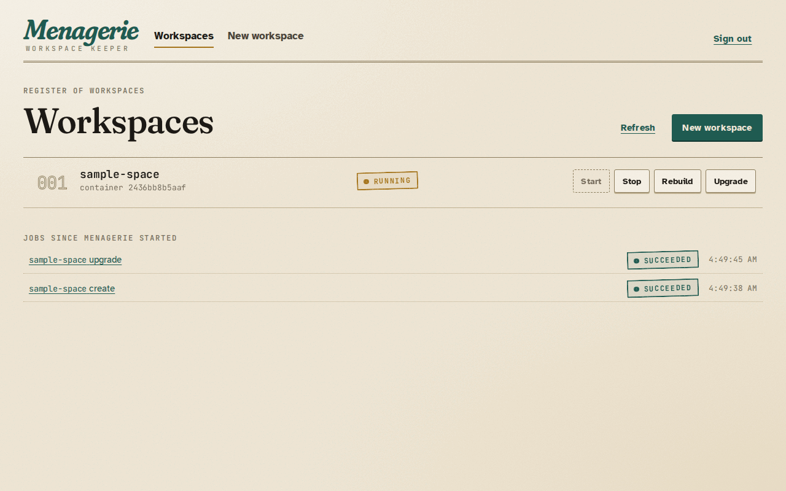
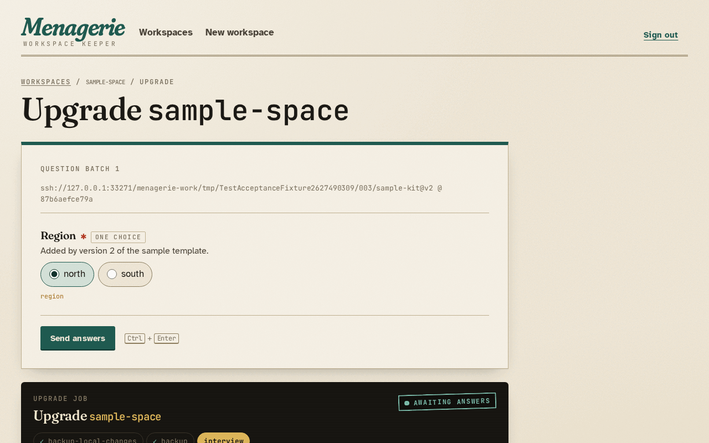

Sign in at Menagerie's address with your identity provider. Members of
`menagerie_managers` see the workspace list; anyone else sees a page that
says they are not a manager, and can change nothing.

## The workspace list

Every folder in the workspace root is a row, with its container's state:
**Running**, **Stopped**, or **No container** for a folder whose
devcontainer was never created. Containers that belong to no folder in the
root do not appear. **Refresh** reads the folders and containers again.

Each row has **Stop**, **Start**, **Rebuild** and **Upgrade**. A commit,
from the [schedule or the workspace itself](#commit-from-inside-a-workspace),
shows on its row as **committing**. Rebuild asks
for confirmation, then removes the container and creates it again from the
workspace's definition. While a job runs on a workspace, its row is busy and
its actions wait: a workspace runs one job at a time. Other workspaces stay
usable.

**Jobs since Menagerie started** lists every job and its outcome. Open one to
see its console. Jobs live in memory, so the list starts empty after a
restart.



## Create a workspace

Choose **New workspace**, pick a template and enter the workspace's name,
which becomes its folder. **Begin interview** asks the template's questions.
Answers that the template refuses come back marked on their questions, with
your answers kept, so you can correct them and send again. Nothing is
written until the interview is complete.

The job console then shows each phase:

1. `initialize-repository`: the folder becomes a Git repository.
2. `generate`: Toha writes the files and runs the template's hooks, each in
   a throwaway container that sees only the workspace folder. Output a hook
   does not capture appears in the console, each line prefixed `hook: `.
3. `commit` and `backup`: the first commit, pushed to the workspace's own
   orphan branch in the workspace repository.
4. `initialize-command`: the devcontainer's `initializeCommand`, in
   throwaway containers that see only the workspace folder, with only the
   variables of [`local-env`](configuration.md#local-environment) beside
   the [runner image](configuration.md#runner-images)'s own.
5. `build` when the definition builds an image, then `up`: the devcontainer
   starts.

The answers are kept in the workspace, in `.toha.json`.


## Upgrade a workspace

**Upgrade** offers the approved templates. Pick the newer version and choose
**Begin upgrade**. Menagerie first commits any local changes and backs the
workspace up, so the state before the upgrade is on its branch. Then it asks
only the questions the new version adds; earlier answers come from
`.toha.json`. Toha applies the new version to a separate checkout of the
workspace and runs the template's hooks there, each in a throwaway
container that sees only that checkout; then it merges the result into
the files, keeping your edits, and Menagerie commits, backs up and
rebuilds the devcontainer.

When the new version and a local edit change the same lines, the upgrade
writes conflict markers, commits and backs them up, and stops before the
rebuild with `merge-conflicted`. Resolve the conflicts in the workspace,
then choose **Rebuild**.



## Backups

Each workspace is backed up to a branch named after its folder, created
without a parent and replaced by force at every backup. To restore a
workspace, clone its branch into a folder in the workspace root by hand;
Menagerie lists it like any other folder.

## Commit from inside a workspace

When Menagerie has [workspace sockets](configuration.md#workspace-sockets),
every devcontainer has `/run/menagerie/bin/workspace-commit`. It commits
every change of the workspace, as `git add --all` and a commit would, and
backs the workspace's branch up:

```sh
/run/menagerie/bin/workspace-commit -m "feat: add the build scripts"
```

It waits for the job and prints its id, the commit, and whether the backup
pushed it. A commit job also appears in **Jobs since Menagerie started**,
with its whole log. The exit status says what happened:

| Status | Meaning |
| --- | --- |
| 0 | Committed (or nothing to commit) and backed up. |
| 1 | The job failed, as `commit-failed` or `backup-failed` for example. The job's console has the detail. |
| 2 | Usage error, or a message that is blank, longer than 4096 bytes, or holds a NUL. |
| 3 | The workspace has a job in progress, committed less than the minimum interval ago, or Menagerie is shutting down. It prints when to retry. |
| 4 | The socket cannot be reached: the container was created before Menagerie had workspace sockets, or Menagerie is not running. |

A container gets the socket when it is created or rebuilt, so a workspace
whose container was created before sockets were configured needs one
**Rebuild**; a **Start** keeps that container as it is, and its console
says the socket attaches at the next rebuild. A restart of
Menagerie does not: the socket comes back in the same mounted folder.
`MENAGERIE_WORKSPACE_SOCKET` names the socket inside the devcontainer.

With [automatic commits](configuration.md#automatic-commits), Menagerie
also commits a workspace with changes on a schedule, with the message
`chore(menagerie): automatic commit`.

## Stop, start and rebuild

Start runs `initializeCommand` before it starts the container, as rebuild
does. When `initializeCommand` fails, the job fails with
`initialize-command-failed` and the container stays stopped.

## Time limits

The job console shows how long a job has run. When the configuration sets
[job time limits](configuration.md#job-time-limits), it also shows the
limit that ends first and the time left; while a job waits for your
answers the limit pauses. A job past its limit fails with `timed-out`, and
the message names the phase and the limit.
