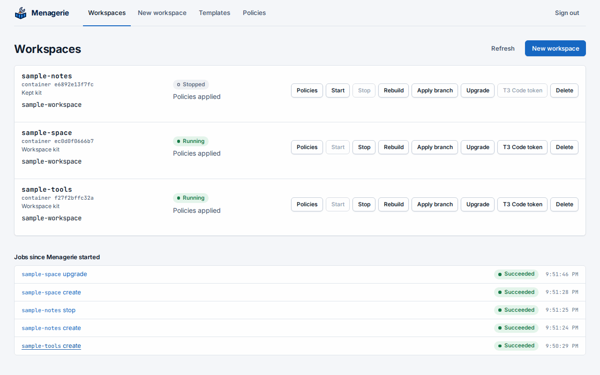
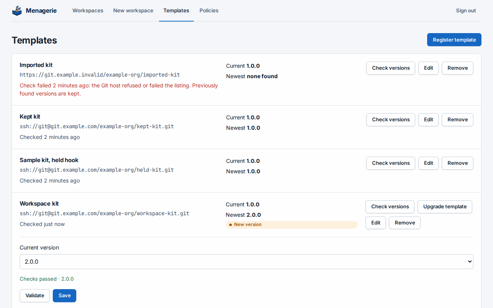
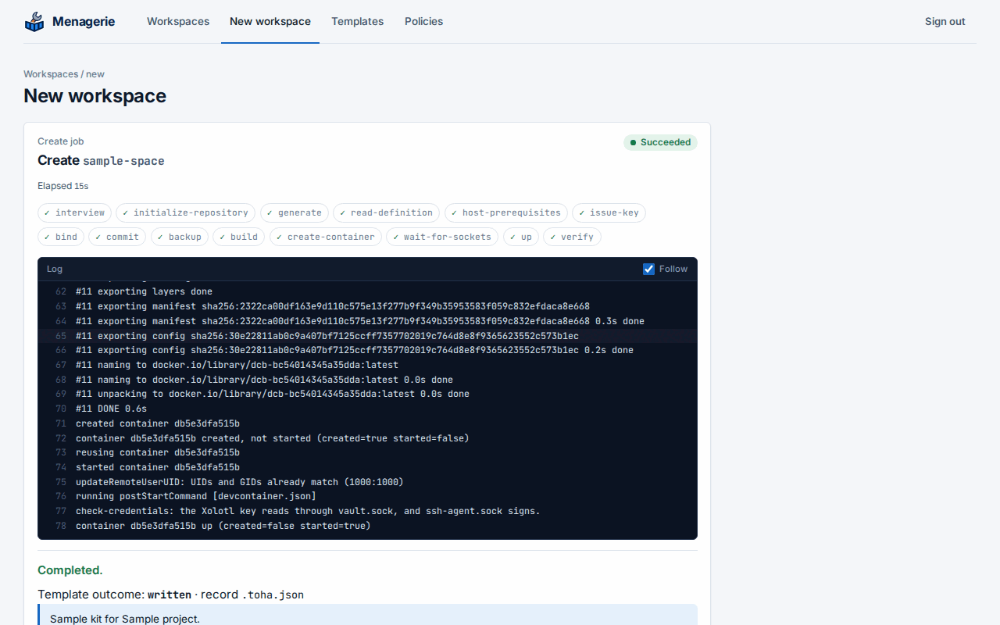
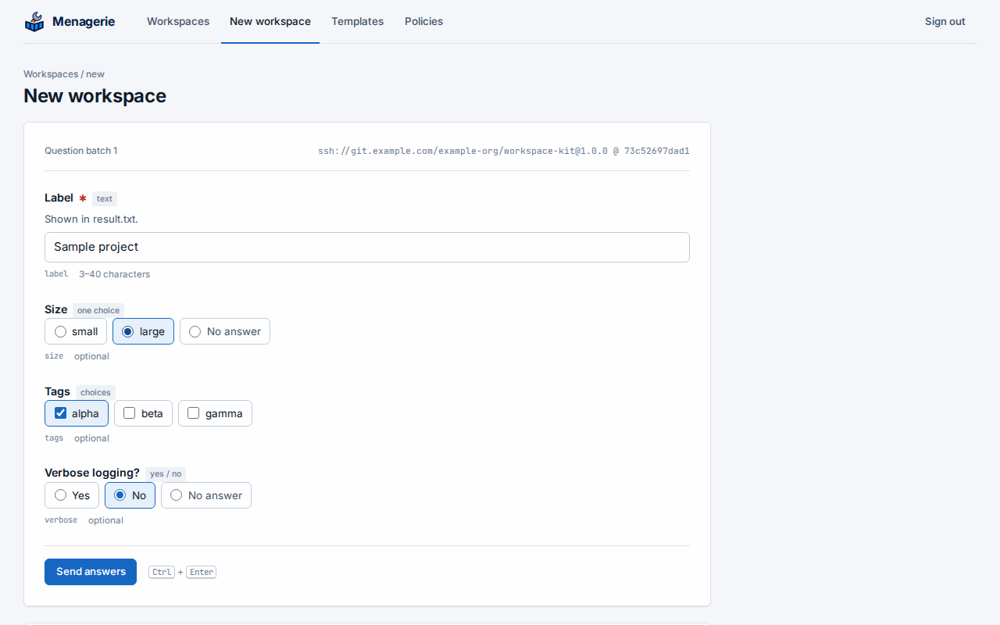
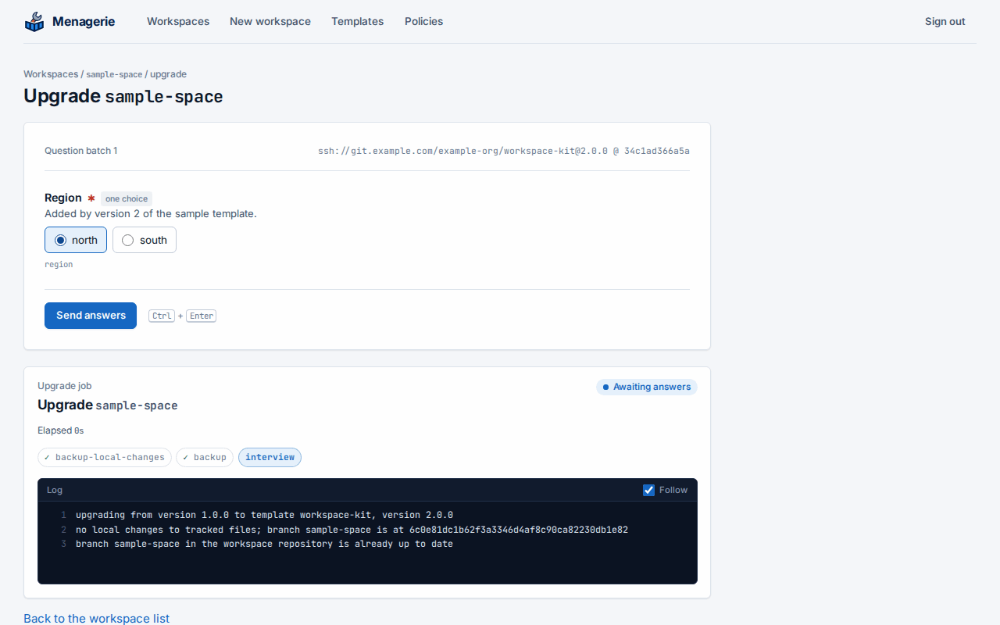
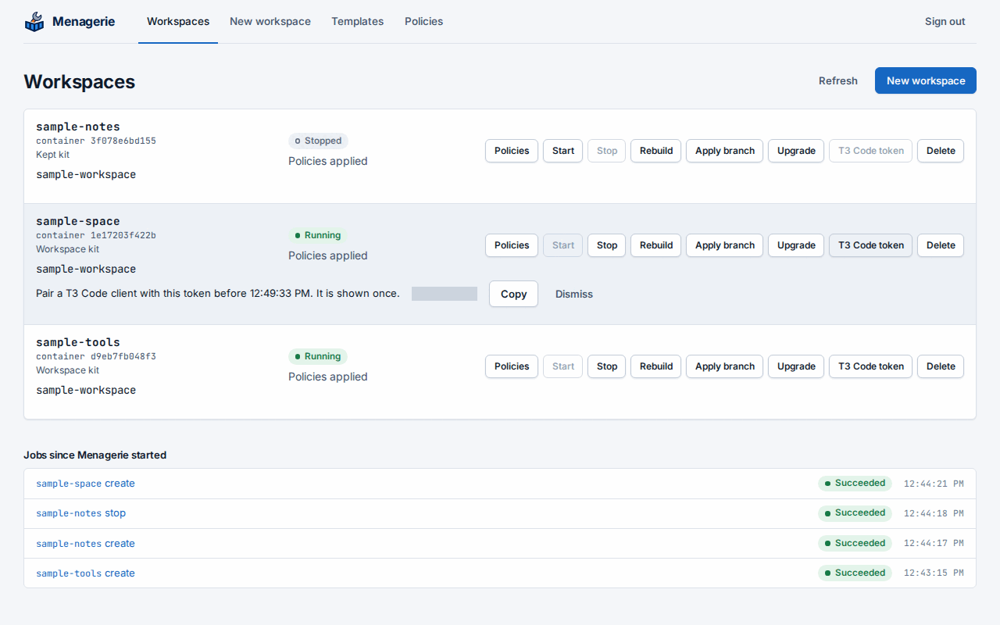
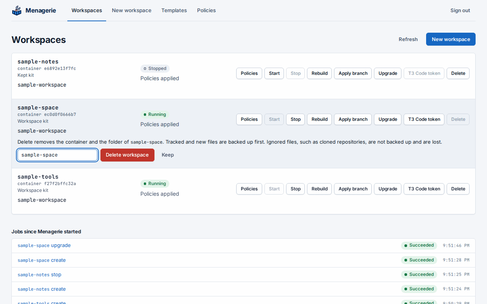

Sign in at Menagerie's address with your identity provider. Members of
`menagerie_managers` see the workspace list; anyone else sees a page that
says they are not a manager, and can change nothing.

## The workspace list

Every folder in the workspace root is a row, unless its name starts with a
dot, with its container's state:
**Running**, **Stopped**, or **No container** for a folder whose
devcontainer was never created. Containers that belong to no folder in the
root do not appear. A workspace whose folder is gone, for which Menagerie
still holds a Wyrwood binding or a Xolotl key, is a row too, marked **No
folder**: it offers only [**Delete**](#delete-a-workspace), which removes
them. **Refresh** reads the folders, the containers and Menagerie's data
again.

Each row names its [template](#templates), or **Unregistered template** for a
workspace whose template is not registered; such a workspace keeps working and
joins its template when a manager registers it.

Each row lists its selected policies, or **No policies** for an empty selection.
**Needs choice** names any policy group without a valid choice: exactly one
policy for a single-select group, at least one for a multi-select group.
**Policies applied**, **Policies pending**, **Policies failed** or
**Policy import pending** shows whether the binding has the stored selection.
A failed apply shows its message on the row.

Each row has **Stop**, **Start**, **Rebuild**, **Apply branch**, **Upgrade**
and [**T3 Code token**](#connect-t3-code-to-a-workspace). A commit,
from the [schedule or the workspace itself](#commit-from-inside-a-workspace),
shows on its row as **committing**. Rebuild asks
for confirmation, then removes the container and creates it again from the
workspace's definition. While a job runs on a workspace, its row is busy and
its actions wait: a workspace runs one job at a time. Other workspaces stay
usable.

**Jobs since Menagerie started** lists every job and its outcome. Open one to
see its console. Jobs live in memory, so earlier jobs are gone after a
restart. The list can start with **apply-policies** jobs: at startup, Menagerie
tries each workspace whose binding does not have its stored policy selection.



## Templates

Workspaces come from registered templates. Choose **Templates** to see each
one, its address and its current version, the version a new workspace gets
and an upgrade applies. Registering, upgrading and removing a template needs
no configuration change and no restart.

A version is a release tag of the template's repository: `MAJOR.MINOR.PATCH`,
with an optional leading `v`, such as `1.2.0` or `v1.2.0`. A tag with a
pre-release or build part, such as `1.2.0-rc.1`, is not a version, and when
`1.2.0` and `v1.2.0` both exist they are one version.

### Register a template

Choose **Register template**, enter a display name, the template's address
and, when its hooks need one, a [runner image](configuration.md#runner-images),
then **Save**. The address takes the forms and credentials in
[Templates](configuration.md#templates): `gh:owner/repository`,
`git@host:path`, `ssh://` or `https://`, with an optional `#folder`. With no
ref, the template's current version is the repository's newest version; with
a version's tag, such as `gh:example-org/kit@1.2.0`, it is that version. Its
id, which never changes, comes from the name.

Menagerie checks the template first and refuses it at the first check that
fails, naming that check beside **Save**. The message never repeats the
address:

| Check        | Refused when                                                                                                                          |
| ------------ | ------------------------------------------------------------------------------------------------------------------------------------- |
| `address`    | The address is not one of those forms: a folder, `file://`, a template name, `git://`, `http://`, or a password, even one holding `/` |
| `fetch`      | The repository's versions cannot be listed: it does not exist, or the Git host refuses the credentials                                |
| `version`    | The repository has no version, or the address's ref is not a version's tag                                                            |
| `fetch`      | The current version cannot be fetched                                                                                                 |
| `read`       | Toha cannot load the template, or its folder or a link in it leads outside its repository                                             |
| `definition` | The template's files have no `.devcontainer/devcontainer.json`                                                                        |

A template whose repository and folder are registered already is refused,
naming that registration. Registering a template joins the workspaces whose
applied record, `.toha.json`, names it.

### Upgrade a template

When the template's repository has a newer version, choose **Upgrade template**
on its row, enter that version and **Save**. The version passes the `fetch`,
`read` and `definition` checks before it becomes the current version. A
version that is not one of the repository's versions newer than the current
one is refused: a template moves only forward. Workspaces keep the version
they have until you [upgrade them](#upgrade-a-workspace).



**Edit** renames a template or changes its runner image; its address does not
change. **Remove** removes a template no workspace uses; while workspaces use
it, it is refused, naming them.

## Policies

Choose **Policies** to see the policies Menagerie's Wyrwood operator key can
grant. Each row says **Inside grant** or **Outside grant**. A policy referenced
by the settings or a workspace stays visible if it leaves the grant or is
removed from Wyrwood. Widen the operator key's grant in Wyrwood before adding
that policy to settings.

Mark **Required** to add a policy to every workspace's selection. Removing the
required mark leaves the policy in each selection that already has it.

Choose **Add group**, enter its name, choose **Single-select** (exactly one
policy) or **Multi-select** (at least one), and select the group's policies.
**Remove group** removes the rule and keeps the workspaces' selected policies.
A policy is required, in one group, or neither; group names are unique and
each group needs at least one policy. **Save** stores the changes together.

If someone saved settings after you opened the page, your save is refused.
**Reload settings** reads their changes so you can decide again. A refused
save shows its error beside **Save** and keeps your edits. If the first read
fails, **Retry** reads the settings again. Without `provisioning.wyrwood`, the
settings controls are disabled.

Choose **Policies** on a workspace's row to edit its selection. Required
policies stay selected; choose exactly one policy in each single-select group
and at least one in each multi-select group. **Save** stores the selection and
applies it to Wyrwood immediately, without a rebuild or a file edit. While
another job runs on that workspace, the selection waits and applies afterwards.
A stale save keeps your edits; **Reload policies** reads the latest selection.

A pending or failed apply keeps the selection stored. Open its job console for
the answer, then choose **Apply again** to retry. A workspace with no current
container name needs no binding request. For a bound workspace, an empty
selection is sent to Wyrwood like any other. Wyrwood refuses it as
`binding-refused`; the binding keeps its earlier policies and the selection
stays unapplied. Add a policy and save to recover.

An edit made directly in Wyrwood is replaced by the stored selection on the
next apply, start or rebuild. A binding removed in Wyrwood is made again by the
next apply or start once the workspace has a policy. With none, Wyrwood refuses
it (`binding-refused`); adding a policy restores it. A binding outside the
operator key's grant fails as `binding-outside-grant`; widen the grant before
retrying.

## Create a workspace

Choose **New workspace**, pick a registered template, shown with its current
version, and enter the workspace's name, which becomes its folder. The
workspace gets the template's current version. Required policies are selected
already. Choose a policy in each group, exactly one in a single-select group,
and any other policies the workspace needs. **Begin interview** asks the
template's questions. Answers that the template refuses come back marked on
their questions, with your answers kept, so you can correct them and send
again. Nothing is written until the interview is complete.

The job console then shows each phase:

1. `initialize-repository`: the folder becomes a Git repository.
2. `generate`: Toha writes the files and runs the template's hooks, each in
   a throwaway container that sees only the workspace folder. Output a hook
   does not capture appears in the console, each line prefixed `hook: `.
3. `host-prerequisites`: Docker checks the bind sources outside the workspace
   folder and the networks of `runArgs`. The job fails as
   `host-prerequisites-missing` when the host lacks any, and the message names
   them all. Nothing is committed or started.
4. `commit` and `backup`: the first commit, pushed to the workspace's own
   orphan branch in the workspace repository.
5. `initialize-command`: the devcontainer's `initializeCommand`, in
   throwaway containers that see only the workspace folder, with only the
   variables of [`local-env`](configuration.md#local-environment) beside
   the [runner image](configuration.md#runner-images)'s own.
6. `build` when the definition builds an image, then `up`: the devcontainer
   starts.

The answers are kept in the workspace, in `.toha.json`.

If a branch with the workspace's name is already in the workspace repository,
from a workspace that was deleted, the `backup` phase first copies it to
`archive/<name>-<UTC stamp>`, and the console names the copy.

When a create fails after `generate`, **Start** finishes it: the commit and
backup that did not run, then the devcontainer. Until its first backup lands, any
job's first push copies the earlier branch first. A second create of that name is
refused while the folder exists. On a provisioning host, a create with no
policy reaches `bind` and fails as `binding-refused`; its files and key may
already exist. Add a policy on its row and choose **Start** to finish it.

### A workspace with a provisioning declaration

A template that renders a `customizations.menagerie` block in its definition
gets a Wyrwood binding and, with Xolotl configured on the host, a client key,
with no
step in a CLI or a web interface, once the [host is
prepared](install.md#provisioning). The declaration supplies the access group.
Menagerie supplies the workspace's selected policies, their values (the
workspace name for each value) and its immutable Xolotl key identity. Legacy
`policies`, `values` and `xolotl` template members are ignored and named in the
console. Imported workspaces keep their earlier values and key. The container
gets `MENAGERIE_XOLOTL_KEY` (`policy/name`); an explicit `containerEnv` value wins.
A start of an existing container leaves its environment as it is until rebuild.
The console shows these phases in a create:

1. `read-definition`: the block is read and checked. The job fails as
   `provisioning-invalid` when the block is not valid, when the definition has
   no `--name` in `runArgs`, when Menagerie holds the container name or the key
   for another workspace, and when a container of another workspace has the
   name. The job fails as `provisioning-unavailable` when
   [`provisioning`](configuration.md#provisioning) lacks the section the block
   needs.
2. `host-prerequisites`, as above.
3. `issue-key`: the Xolotl key, which Menagerie records as the workspace's
   first. A key that exists stays as it is, and the console says when it is
   disabled or expires.
4. `bind`: the Wyrwood binding, whose container name Menagerie records as the
   workspace's first. An existing binding is changed at its read revision to
   hold the selection and values with the declared access group; the console
   names additions and removals. A pending answer is retried up to three times;
   `binding-pending` asks for another apply. A concurrent change is read again
   once, then fails as `binding-changed` if it happens again.
   A binding Menagerie made on another Wyrwood agent, before
   `provisioning.wyrwood.agent` changed, is removed first, and Menagerie keeps
   its record until Wyrwood confirms it gone.
5. `commit` and `backup`, `initialize-command` and `build`, as above.
6. `create-container`: the container, not started. A bind with an SELinux `z` or
   `Z` option or `bind-create-src` fails here, so such a definition uses neither.
7. `wait-for-sockets`: the job reads the binding's status until the agent reports
   this container with the declared access group and both sockets. The console
   shows each change of the status and the agent's last error.
8. `up`: the container starts, with its sockets, and its lifecycle commands run.
9. `verify`: the status again, with the container running. What the container
   needs from its sockets is the template's to check in a lifecycle command,
   whose failure fails the job.

Each step is safe to repeat. A job that fails leaves what it finished, and
**Start** continues from what is missing: it does not rotate the key or write
the binding again. It replaces a container that has a name the definition no
longer declares, because a rebuild that failed left it. **Start** is off while a
container runs, so after an upgrade that failed with the old container still
running, **Stop** it, then **Start**. A rebuild, an upgrade's
rebuild and an apply-branch's rebuild run the same steps without the commit and
backup. A start of a container that exists goes on when Xolotl cannot be
reached, with a note in the console; any other failure of a step fails the job.

Menagerie keeps each container name it binds and each Xolotl key it issues for a
workspace in its own data, not in the definition, so what it made is known
however the definition changes later. Any job that ends with the devcontainer
started, with or without a block, then runs `retire`: it unbinds each name and
revokes each key the definition no longer declares, every one when the
definition has no block, and forgets each once Wyrwood or Xolotl confirms it
gone. So an upgrade, an apply-branch or a hand edit that declares another
container name binds the new name and retires the old one at the job's end. A
block that is not valid fails the job in `read-definition` and changes nothing:
the binding, its name and the container stay as they were. A binding that Wyrwood
answers is outside the operator key's grant stays, Menagerie keeps its name, and
the job fails as `binding-outside-grant`, naming it, with the devcontainer
running; widen the grant or remove the binding in the Wyrwood web interface, then
start the workspace again.

Before each create, start, rebuild and upgrade, Menagerie creates any missing
bind source folder inside the workspace folder, so a clone of a backup starts:
Git keeps no empty folder. The job console names each folder it creates.

A string in `mounts` is read as Docker's `--mount` value: without `type=` it
is a volume, not a bind, and a space around a field or a value is refused.





## Upgrade a workspace

**Upgrade** applies the current version of the workspace's template, which
the screen names, so [upgrade the template](#upgrade-a-template) first to take
a newer version. Choose **Begin upgrade**. An upgrade is refused when the
workspace already has that version or a newer one, and when its template is
not registered. Menagerie first commits any local changes and backs the
workspace up, so the state before the upgrade is on its branch. Then it asks
only the questions the new version adds; earlier answers come from
`.toha.json`. Toha applies the new version to a separate checkout of the
workspace and runs the template's hooks there, each in a throwaway
container that sees only that checkout; then it merges the result into
the files, keeping your edits, and Menagerie commits, backs up and
rebuilds the devcontainer. The upgrade leaves the workspace's selected policies
unchanged.

An earlier answer that still fits the new version is not asked again, even
when the new version adds options to its question. To change it, check
**Ask every question again** before **Begin upgrade**: every question is
asked, filled in with the workspace's recorded answers, and a question you
leave as it is keeps its answer. Documents are still read from their files
in the workspace.

When the new version and a local edit change the same lines, the upgrade
writes conflict markers, commits and backs them up, and stops before the
rebuild with `merge-conflicted`. Resolve the conflicts in the workspace,
then choose **Rebuild**.



## Apply a reviewed branch

A change to a workspace, such as its `.devcontainer/` content, can be
proposed and reviewed as a pull request, then brought into the workspace
with **Apply branch**:

1. Push the change to a branch of the workspace repository and open a pull
   request whose base is the workspace's branch.
2. Review it, but do not merge it on the forge: the workspace's next backup
   would replace the merge.
3. In the workspace's row, choose **Apply branch**, enter the pull
   request's head branch, for example `review/devcontainer`, and choose
   **Apply**.

The job console shows each phase:

1. `fetch`: Menagerie fetches only that branch from the workspace
   repository.
2. `backup-local-changes` and `backup`: it commits every local change, as
   a [commit](#commit-from-inside-a-workspace) does, and backs the
   workspace up. When the branch is the workspace's own, it commits but
   does not push, and there is no `backup` phase here, so that the
   branch's commits stay on the workspace repository.
3. `plan`: Menagerie works out the apply without writing anything. When
   the branch extends the workspace's branch, the workspace fast-forwards
   to it. When both have changed, Menagerie merges them file by file and
   commits the merge as `Apply <branch> to workspace <workspace>`. A plan
   that cannot apply fails here and leaves the devcontainer running.
4. `stop`: the devcontainer stops, with every service of its Compose
   project, so that nothing writes to the workspace while the apply does.
   What it wrote before it stopped is committed (and backed up, for
   another branch than the workspace's own), and the plan is made again.
5. `apply`: Menagerie refuses while another running container mounts the
   workspace folder (the console names it by its short id), then writes
   only the files that change.
6. `backup`, then the rebuild of the devcontainer.

When the apply is refused after the stop, nothing is applied and the
devcontainer returns to its state before the job: Menagerie starts it
again if it was running. Whenever a job leaves the devcontainer stopped,
its console ends with "the devcontainer is stopped; start or rebuild
it".

The backup after the apply pushes the branch's commits to the workspace's
branch, and the forge marks the pull request merged. A branch already in
the workspace's history changes nothing and does not rebuild; when it is
the workspace's own branch, the job still backs the workspace up.

Menagerie writes only through real folders of the workspace, never
through a symbolic link, and moves the files it replaces to
`.menagerie-apply-…` names first. When the job fails as `apply-failed`,
the devcontainer stays stopped, and the message and console name each
file still under such a name with its path.

The job fails, with nothing applied, when:

| Kind | Meaning |
| --- | --- |
| `branch-not-found` | The workspace repository has no branch of that name. Nothing changed, local changes included. |
| `fetch-failed` | The workspace repository could not be reached. Nothing changed. |
| `not-applicable` | The branch cannot be applied cleanly. The console lists the paths, one `not applicable:` line each, and the message says why: both sides changed the same file, the branch and the workspace share no history (or more than one merge base), an untracked or ignored file, folder or link, or a nested repository, is where the branch writes, the change has a submodule or a path Menagerie does not write (a `.git` part in any spelling, `git~1`, an absolute path, a tab or a newline), a file changed while the job ran (the change is kept), another running container mounts the workspace folder, the workspace repository is shallow, or part of the branch's history is missing. Local changes are committed, and backed up unless the branch is the workspace's own. Rebase the branch on the workspace's branch, or move the files in the way, and apply again. |
| `backup-failed` | The backup before or after the apply failed. The message says which; a failed backup after the apply leaves the applied files and does not rebuild. |
| `apply-failed` | Writing the files failed partway. The branch did not move; the message names the commit to recover from by hand. |

A merge never writes conflict markers: a file both sides changed is
`not-applicable`. The applied record `.toha.json` is merged like any other
file. Prefer a branch that is not the workspace's own. When an apply of
the workspace's own branch is refused, the workspace repository keeps the
pushed commits, and the message names the fetched commit, until the next
backup of the workspace replaces them.

## Backups

Each workspace is backed up to a branch named after its folder, created
without a parent and replaced by force at every backup. Commits pushed to
that branch from elsewhere survive only when
[Apply branch](#apply-a-reviewed-branch) brings them in before the next
backup. To restore a workspace, clone its branch into a folder in the
workspace root by hand; Menagerie lists it like any other folder.

## Commit from inside a workspace

When Menagerie has [workspace sockets](configuration.md#workspace-sockets),
every devcontainer has `/run/menagerie/bin/workspace-commit`. It commits
every change of the workspace, as `git add --all` and a commit would, and
backs the workspace's branch up:

```sh
/run/menagerie/bin/workspace-commit -m "feat: add the build scripts"
```

It waits for the job and prints its id, the commit, and whether the backup
pushed it. A commit job also appears in **Jobs since Menagerie started**,
with its whole log. The exit status says what happened:

| Status | Meaning |
| --- | --- |
| 0 | Committed (or nothing to commit) and backed up. |
| 1 | The job failed, as `commit-failed` or `backup-failed` for example. The job's console has the detail. |
| 2 | Usage error, or a message that is blank, longer than 4096 bytes, or holds a NUL. |
| 3 | The workspace has a job in progress, committed less than the minimum interval ago, or Menagerie is shutting down. It prints when to retry. |
| 4 | The socket cannot be reached: the container was created before Menagerie had workspace sockets, or Menagerie is not running. |

A container gets the socket when it is created or rebuilt, so a workspace
whose container was created before sockets were configured needs one
**Rebuild**; a **Start** keeps that container as it is, and its console
says the socket attaches at the next rebuild. A **Start** that recreates
the container for a changed definition also leaves the socket out until
the next rebuild. A restart of
Menagerie does not: the socket comes back in the same mounted folder.
`MENAGERIE_WORKSPACE_SOCKET` names the socket inside the devcontainer.

With [automatic commits](configuration.md#automatic-commits), Menagerie
also commits a workspace with changes on a schedule, with the message
`chore(menagerie): automatic commit`.

## Connect T3 Code to a workspace

**T3 Code token** mints a pairing token on a running workspace whose
devcontainer has the
[t3code-server Feature](https://github.com/wyrd-company/devcontainers/tree/main/src/features/t3code-server). Pair a T3 Code
client with the token that appears on the row. T3 Code sets the token's
lifetime, shows it as `menagerie` in the server's connections list, and gives
it its default scopes. These are full control of the workspace's T3 Code.

Menagerie shows the token once and keeps no copy. **Dismiss** clears it from
the page. The button also works while a job runs on the workspace. A refusal
appears on the row: `workspace-not-running` when the container has stopped,
`t3-code-not-installed` when the container does not have the Feature.



## Stop, start and rebuild

Start runs `initializeCommand` before it starts the container, as rebuild
does. When `initializeCommand` fails, the job fails with
`initialize-command-failed` and the container stays stopped.

## Delete a workspace

**Delete** on a row asks you to type the workspace's name, and removes the
workspace from the host. Ignored files, such as cloned repositories, are not in
the backup and are lost. The console shows these phases:

1. `read-definition`: what the workspace holds comes from Menagerie's data, never
   from its definition, so a definition edited so that it no longer parses, or no
   longer declares its binding and key, still has both removed. The job fails as
   `delete-refused` while a running container outside the workspace mounts its
   folder, and as `provisioning-unavailable` when the workspace holds a binding
   or a key that [`provisioning`](configuration.md#provisioning) cannot reach.
   Nothing changes.
2. `stop`: the devcontainer, and for Compose every service of its project.
3. `commit` and `backup`: tracked and new files, as a commit does. A folder with
   no applied record, such as one whose generation failed, has no backup. A
   failure here removes nothing and leaves the devcontainer stopped.
4. `unbind`: each Wyrwood binding Menagerie holds for the workspace. The console
   shows a warning, or a token that may stay valid until it expires. A binding
   that Wyrwood answers is outside the operator key's grant fails the delete as
   `binding-outside-grant`, naming it, before any container, key or folder is
   removed, and Menagerie keeps its name: widen the grant or remove the binding
   in the Wyrwood web interface, then **Delete** again.
5. `remove-container`: the workspace's containers.
6. `revoke-key`: each Xolotl key Menagerie holds for the workspace.
7. `remove-folder`: the workspace socket's folder, then the workspace folder. A
   throwaway container that runs as root removes the folder, in the
   [runner image](configuration.md#runner-images), which needs `sh`, `mv` and
   `find`.

A failed delete keeps what it finished. **Delete** again continues from what is
left. Once `remove-folder` has taken the repository, **Start** and **Rebuild**
fail as `delete-unfinished`, and **Delete** finishes the removal with no second
backup.

These stay: the workspace's branch in the workspace repository, images, Compose
volumes and networks, and bind sources outside the folder. A later create of that
name copies the branch to `archive/<name>-<UTC stamp>` first. The agent's empty
consumer directory stays until the next host restart.

A workspace marked **No folder** is deleted by the same phases without `stop`,
`commit` and `backup`, and its `remove-folder` removes only its workspace socket's
folder. Menagerie forgets the workspace once its folder is gone.



## Time limits

The job console shows how long a job has run. When the configuration sets
[job time limits](configuration.md#job-time-limits), it also shows the
limit that ends first and the time left; while a job waits for your
answers the limit pauses. A job past its limit fails with `timed-out`, and
the message names the phase and the limit.
