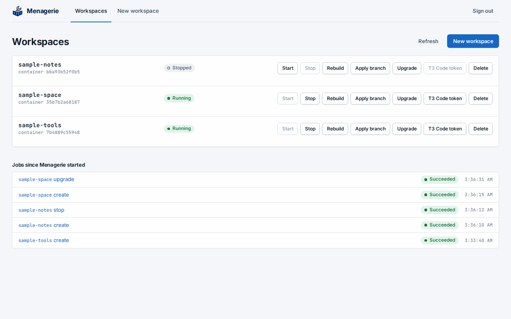
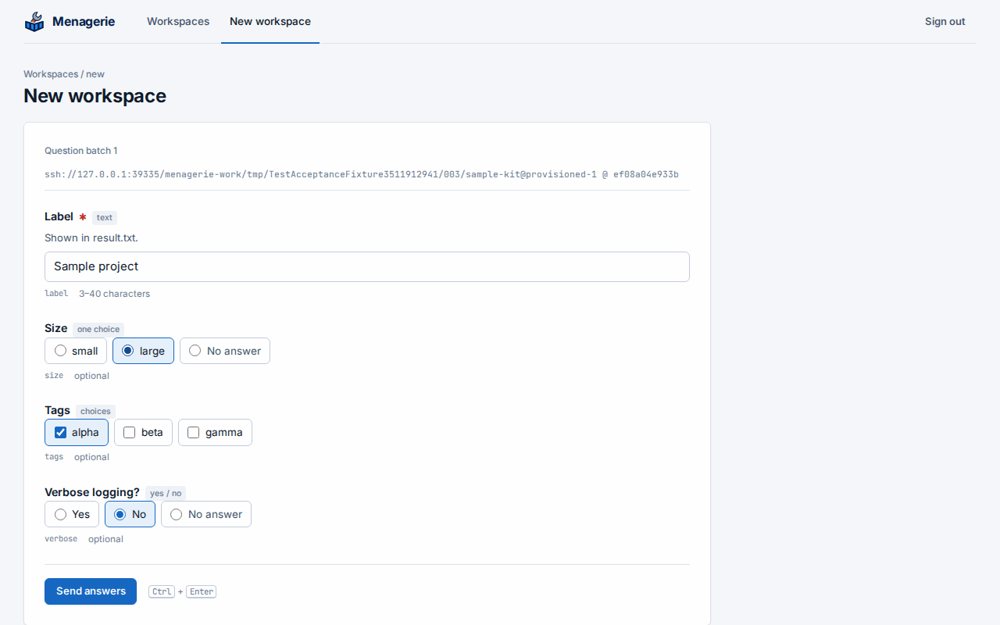
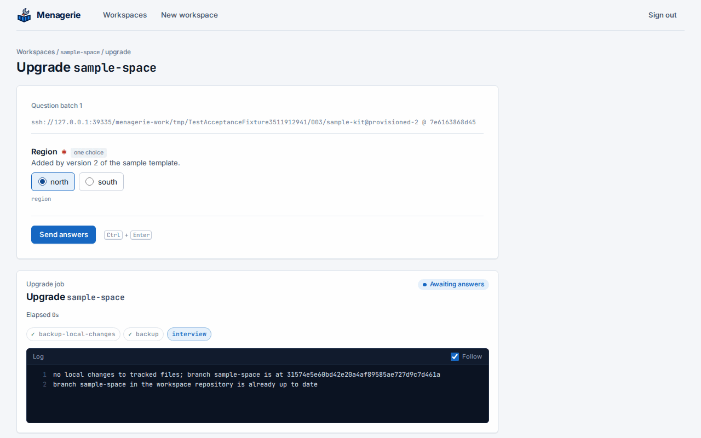

Sign in at Menagerie's address with your identity provider. Members of
`menagerie_managers` see the workspace list; anyone else sees a page that
says they are not a manager, and can change nothing.

## The workspace list

Every folder in the workspace root is a row, unless its name starts with a
dot, with its container's state:
**Running**, **Stopped**, or **No container** for a folder whose
devcontainer was never created. Containers that belong to no folder in the
root do not appear. **Refresh** reads the folders and containers again.

Each row has **Stop**, **Start**, **Rebuild**, **Apply branch**, **Upgrade**
and [**T3 Code token**](#connect-t3-code-to-a-workspace). A commit,
from the [schedule or the workspace itself](#commit-from-inside-a-workspace),
shows on its row as **committing**. Rebuild asks
for confirmation, then removes the container and creates it again from the
workspace's definition. While a job runs on a workspace, its row is busy and
its actions wait: a workspace runs one job at a time. Other workspaces stay
usable.

**Jobs since Menagerie started** lists every job and its outcome. Open one to
see its console. Jobs live in memory, so the list starts empty after a
restart.



## Create a workspace

Choose **New workspace**, pick a template and enter the workspace's name,
which becomes its folder. **Begin interview** asks the template's questions.
Answers that the template refuses come back marked on their questions, with
your answers kept, so you can correct them and send again. Nothing is
written until the interview is complete.

The job console then shows each phase:

1. `initialize-repository`: the folder becomes a Git repository.
2. `generate`: Toha writes the files and runs the template's hooks, each in
   a throwaway container that sees only the workspace folder. Output a hook
   does not capture appears in the console, each line prefixed `hook: `.
3. `host-prerequisites`: Docker checks the bind sources outside the workspace
   folder and the networks of `runArgs`. The job fails as
   `host-prerequisites-missing` when the host lacks any, and the message names
   them all. Nothing is committed or started.
4. `commit` and `backup`: the first commit, pushed to the workspace's own
   orphan branch in the workspace repository.
5. `initialize-command`: the devcontainer's `initializeCommand`, in
   throwaway containers that see only the workspace folder, with only the
   variables of [`local-env`](configuration.md#local-environment) beside
   the [runner image](configuration.md#runner-images)'s own.
6. `build` when the definition builds an image, then `up`: the devcontainer
   starts.

The answers are kept in the workspace, in `.toha.json`.

If a branch with the workspace's name is already in the workspace repository,
from a workspace that was deleted, the `backup` phase first copies it to
`archive/<name>-<UTC stamp>`, and the console names the copy.

When a create fails after `generate`, **Start** finishes it: the commit and
backup that did not run, then the devcontainer. Until its first backup lands, any
job's first push copies the earlier branch first. A second create of that name is
refused while the folder exists.

### A workspace with a provisioning declaration

A template that renders a `customizations.menagerie` block in its definition
gets a Wyrwood binding and, when it asks for one, a Xolotl client key, with no
step in a CLI or a web interface, once the [host is
prepared](install.md#provisioning). The console shows these phases in a create:

1. `read-definition`: the block is read and checked. The job fails as
   `provisioning-invalid` when the block is not valid, when the definition has
   no `--name` in `runArgs`, and when another workspace holds the container name
   or the key. The job fails as `provisioning-unavailable` when
   [`provisioning`](configuration.md#provisioning) lacks the section the block
   needs.
2. `host-prerequisites`, as above.
3. `issue-key`: the Xolotl key. A key that exists stays as it is, and the
   console says when it is disabled or expires.
4. `bind`: the Wyrwood binding. A binding that differs from the definition is
   removed and made again while the container is stopped, and the console names
   the fields.
5. `commit` and `backup`, `initialize-command` and `build`, as above.
6. `create-container`: the container, not started. A bind with an SELinux `z` or
   `Z` option or `bind-create-src` fails here, so such a definition uses neither.
7. `wait-for-sockets`: the job reads the binding's status until the agent reports
   this container with the declared access group and both sockets. The console
   shows each change of the status and the agent's last error.
8. `up`: the container starts, with its sockets, and its lifecycle commands run.
9. `verify`: the status again, with the container running. What the container
   needs from its sockets is the template's to check in a lifecycle command,
   whose failure fails the job.

Each step is safe to repeat. A job that fails leaves what it finished, and
**Start** continues from what is missing: it does not rotate the key or write
the binding again. It replaces a container that has a name the definition no
longer declares, because a rebuild that failed left it. A rebuild, an upgrade's
rebuild and an apply-branch's rebuild run the same steps without the commit and
backup. A start of a container that exists goes on when Xolotl cannot be
reached, with a note in the console; any other failure of a step fails the job.

Before an upgrade or an apply-branch changes the definition, Menagerie records the
container name and key it declares. A job that ends with the devcontainer started
then runs `retire`: it unbinds each recorded name and revokes each recorded key
that no workspace declares any more. A definition edited by other means has no
record, so what it stops declaring stays until an operator removes it in the
Wyrwood and Xolotl web interfaces.

Before each create, start, rebuild and upgrade, Menagerie creates any missing
bind source folder inside the workspace folder, so a clone of a backup starts:
Git keeps no empty folder. The job console names each folder it creates.

A string in `mounts` is read as Docker's `--mount` value: without `type=` it
is a volume, not a bind, and a space around a field or a value is refused.



## Upgrade a workspace

**Upgrade** offers the approved templates. Pick the newer version and choose
**Begin upgrade**. Menagerie first commits any local changes and backs the
workspace up, so the state before the upgrade is on its branch. Then it asks
only the questions the new version adds; earlier answers come from
`.toha.json`. Toha applies the new version to a separate checkout of the
workspace and runs the template's hooks there, each in a throwaway
container that sees only that checkout; then it merges the result into
the files, keeping your edits, and Menagerie commits, backs up and
rebuilds the devcontainer.

When the new version and a local edit change the same lines, the upgrade
writes conflict markers, commits and backs them up, and stops before the
rebuild with `merge-conflicted`. Resolve the conflicts in the workspace,
then choose **Rebuild**.



## Apply a reviewed branch

A change to a workspace, such as its `.devcontainer/` content, can be
proposed and reviewed as a pull request, then brought into the workspace
with **Apply branch**:

1. Push the change to a branch of the workspace repository and open a pull
   request whose base is the workspace's branch.
2. Review it, but do not merge it on the forge: the workspace's next backup
   would replace the merge.
3. In the workspace's row, choose **Apply branch**, enter the pull
   request's head branch, for example `review/devcontainer`, and choose
   **Apply**.

The job console shows each phase:

1. `fetch`: Menagerie fetches only that branch from the workspace
   repository.
2. `backup-local-changes` and `backup`: it commits every local change, as
   a [commit](#commit-from-inside-a-workspace) does, and backs the
   workspace up. When the branch is the workspace's own, it commits but
   does not push, and there is no `backup` phase here, so that the
   branch's commits stay on the workspace repository.
3. `plan`: Menagerie works out the apply without writing anything. When
   the branch extends the workspace's branch, the workspace fast-forwards
   to it. When both have changed, Menagerie merges them file by file and
   commits the merge as `Apply <branch> to workspace <workspace>`. A plan
   that cannot apply fails here and leaves the devcontainer running.
4. `stop`: the devcontainer stops, with every service of its Compose
   project, so that nothing writes to the workspace while the apply does.
   What it wrote before it stopped is committed (and backed up, for
   another branch than the workspace's own), and the plan is made again.
5. `apply`: Menagerie refuses while another running container mounts the
   workspace folder (the console names it by its short id), then writes
   only the files that change.
6. `backup`, then the rebuild of the devcontainer.

When the apply is refused after the stop, nothing is applied and the
devcontainer returns to its state before the job: Menagerie starts it
again if it was running. Whenever a job leaves the devcontainer stopped,
its console ends with "the devcontainer is stopped; start or rebuild
it".

The backup after the apply pushes the branch's commits to the workspace's
branch, and the forge marks the pull request merged. A branch already in
the workspace's history changes nothing and does not rebuild; when it is
the workspace's own branch, the job still backs the workspace up.

Menagerie writes only through real folders of the workspace, never
through a symbolic link, and moves the files it replaces to
`.menagerie-apply-…` names first. When the job fails as `apply-failed`,
the devcontainer stays stopped, and the message and console name each
file still under such a name with its path.

The job fails, with nothing applied, when:

| Kind | Meaning |
| --- | --- |
| `branch-not-found` | The workspace repository has no branch of that name. Nothing changed, local changes included. |
| `fetch-failed` | The workspace repository could not be reached. Nothing changed. |
| `not-applicable` | The branch cannot be applied cleanly. The console lists the paths, one `not applicable:` line each, and the message says why: both sides changed the same file, the branch and the workspace share no history (or more than one merge base), an untracked or ignored file, folder or link, or a nested repository, is where the branch writes, the change has a submodule or a path Menagerie does not write (a `.git` part in any spelling, `git~1`, an absolute path, a tab or a newline), a file changed while the job ran (the change is kept), another running container mounts the workspace folder, the workspace repository is shallow, or part of the branch's history is missing. Local changes are committed, and backed up unless the branch is the workspace's own. Rebase the branch on the workspace's branch, or move the files in the way, and apply again. |
| `backup-failed` | The backup before or after the apply failed. The message says which; a failed backup after the apply leaves the applied files and does not rebuild. |
| `apply-failed` | Writing the files failed partway. The branch did not move; the message names the commit to recover from by hand. |

A merge never writes conflict markers: a file both sides changed is
`not-applicable`. The applied record `.toha.json` is merged like any other
file. Prefer a branch that is not the workspace's own. When an apply of
the workspace's own branch is refused, the workspace repository keeps the
pushed commits, and the message names the fetched commit, until the next
backup of the workspace replaces them.

## Backups

Each workspace is backed up to a branch named after its folder, created
without a parent and replaced by force at every backup. Commits pushed to
that branch from elsewhere survive only when
[Apply branch](#apply-a-reviewed-branch) brings them in before the next
backup. To restore a workspace, clone its branch into a folder in the
workspace root by hand; Menagerie lists it like any other folder.

## Commit from inside a workspace

When Menagerie has [workspace sockets](configuration.md#workspace-sockets),
every devcontainer has `/run/menagerie/bin/workspace-commit`. It commits
every change of the workspace, as `git add --all` and a commit would, and
backs the workspace's branch up:

```sh
/run/menagerie/bin/workspace-commit -m "feat: add the build scripts"
```

It waits for the job and prints its id, the commit, and whether the backup
pushed it. A commit job also appears in **Jobs since Menagerie started**,
with its whole log. The exit status says what happened:

| Status | Meaning |
| --- | --- |
| 0 | Committed (or nothing to commit) and backed up. |
| 1 | The job failed, as `commit-failed` or `backup-failed` for example. The job's console has the detail. |
| 2 | Usage error, or a message that is blank, longer than 4096 bytes, or holds a NUL. |
| 3 | The workspace has a job in progress, committed less than the minimum interval ago, or Menagerie is shutting down. It prints when to retry. |
| 4 | The socket cannot be reached: the container was created before Menagerie had workspace sockets, or Menagerie is not running. |

A container gets the socket when it is created or rebuilt, so a workspace
whose container was created before sockets were configured needs one
**Rebuild**; a **Start** keeps that container as it is, and its console
says the socket attaches at the next rebuild. A **Start** that recreates
the container for a changed definition also leaves the socket out until
the next rebuild. A restart of
Menagerie does not: the socket comes back in the same mounted folder.
`MENAGERIE_WORKSPACE_SOCKET` names the socket inside the devcontainer.

With [automatic commits](configuration.md#automatic-commits), Menagerie
also commits a workspace with changes on a schedule, with the message
`chore(menagerie): automatic commit`.

## Connect T3 Code to a workspace

**T3 Code token** mints a pairing token on a running workspace whose
devcontainer has the
[t3code-server Feature](https://github.com/wyrd-company/devcontainers/tree/main/src/features/t3code-server). Pair a T3 Code
client with the token that appears on the row. T3 Code sets the token's
lifetime, shows it as `menagerie` in the server's connections list, and gives
it its default scopes. These are full control of the workspace's T3 Code.

Menagerie shows the token once and keeps no copy. **Dismiss** clears it from
the page. The button also works while a job runs on the workspace. A refusal
appears on the row: `workspace-not-running` when the container has stopped,
`t3-code-not-installed` when the container does not have the Feature.

## Stop, start and rebuild

Start runs `initializeCommand` before it starts the container, as rebuild
does. When `initializeCommand` fails, the job fails with
`initialize-command-failed` and the container stays stopped.

## Delete a workspace

**Delete** on a row asks you to type the workspace's name, and removes the
workspace from the host. Ignored files, such as cloned repositories, are not in
the backup and are lost. The console shows these phases:

1. `read-definition`: the job fails as `delete-refused` while a running container
   outside the workspace mounts its folder, and as `provisioning-unavailable`
   when the workspace holds a binding or a key that
   [`provisioning`](configuration.md#provisioning) cannot reach. Nothing changes.
2. `stop`: the devcontainer, and for Compose every service of its project.
3. `commit` and `backup`: tracked and new files, as a commit does. A folder with
   no applied record, such as one whose generation failed, has no backup. A
   failure here removes nothing and leaves the devcontainer stopped.
4. `unbind`: the Wyrwood binding, when the workspace has one. The console shows
   a warning, or a token that may stay valid until it expires.
5. `remove-container`: the workspace's containers.
6. `revoke-key`: the Xolotl key, when the workspace has one.
7. `remove-folder`: the workspace socket's folder, then the workspace folder. A
   throwaway container that runs as root removes the folder, in the
   [runner image](configuration.md#runner-images), which needs `sh`, `mv` and
   `find`.

A failed delete keeps what it finished. **Delete** again continues from what is
left.

These stay: the workspace's branch in the workspace repository, images, Compose
volumes and networks, and bind sources outside the folder. A later create of that
name copies the branch to `archive/<name>-<UTC stamp>` first. The agent's empty
consumer directory stays until the next host restart.

A binding or a key that another workspace's definition declares stays, and the
console says so.

## Time limits

The job console shows how long a job has run. When the configuration sets
[job time limits](configuration.md#job-time-limits), it also shows the
limit that ends first and the time left; while a job waits for your
answers the limit pauses. A job past its limit fails with `timed-out`, and
the message names the phase and the limit.
